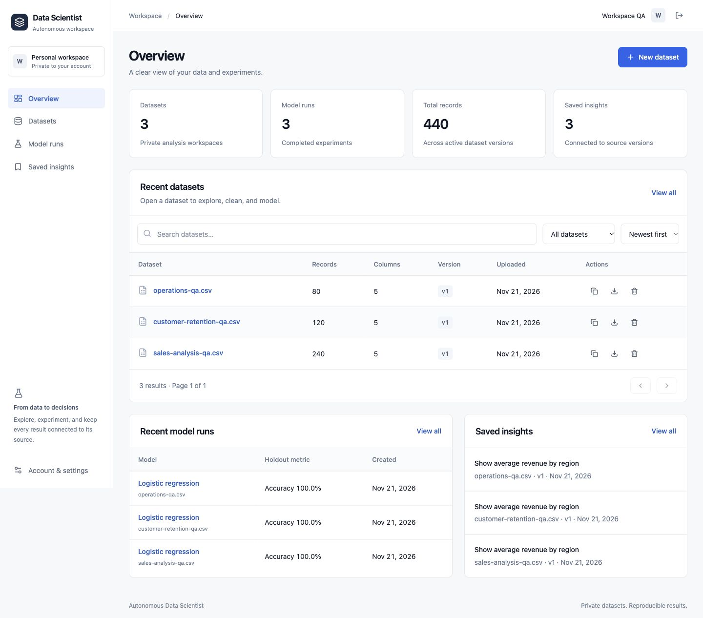
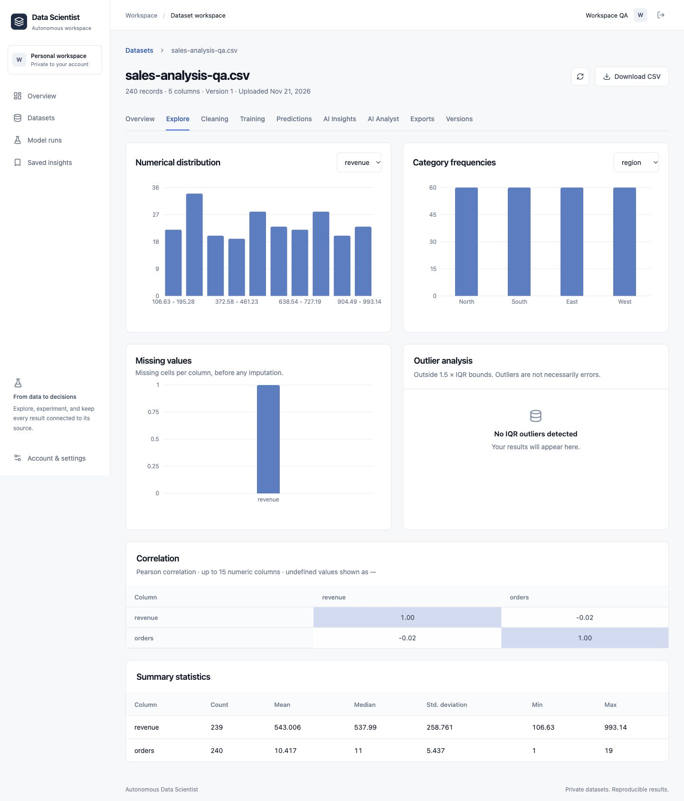
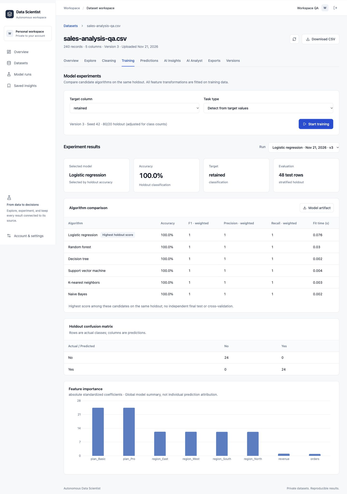
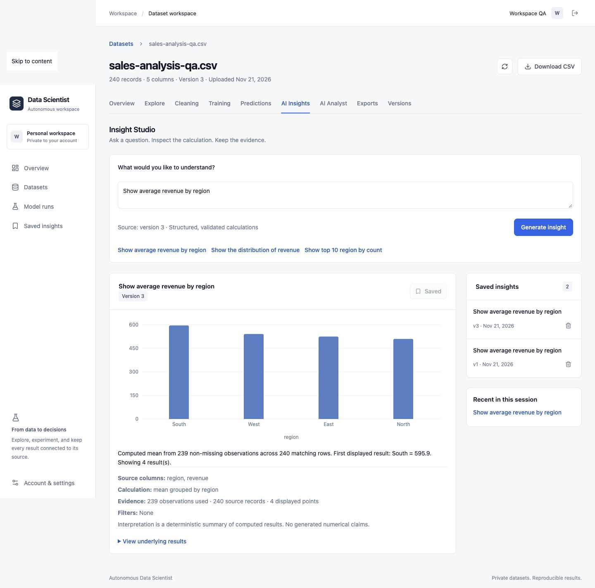
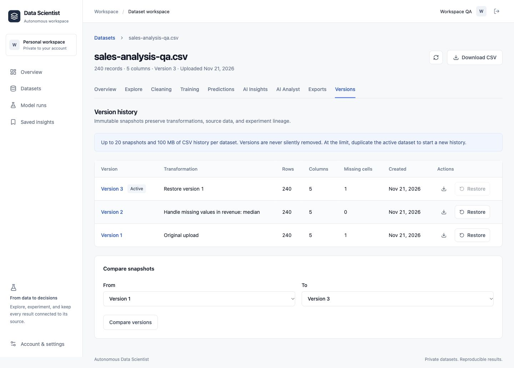
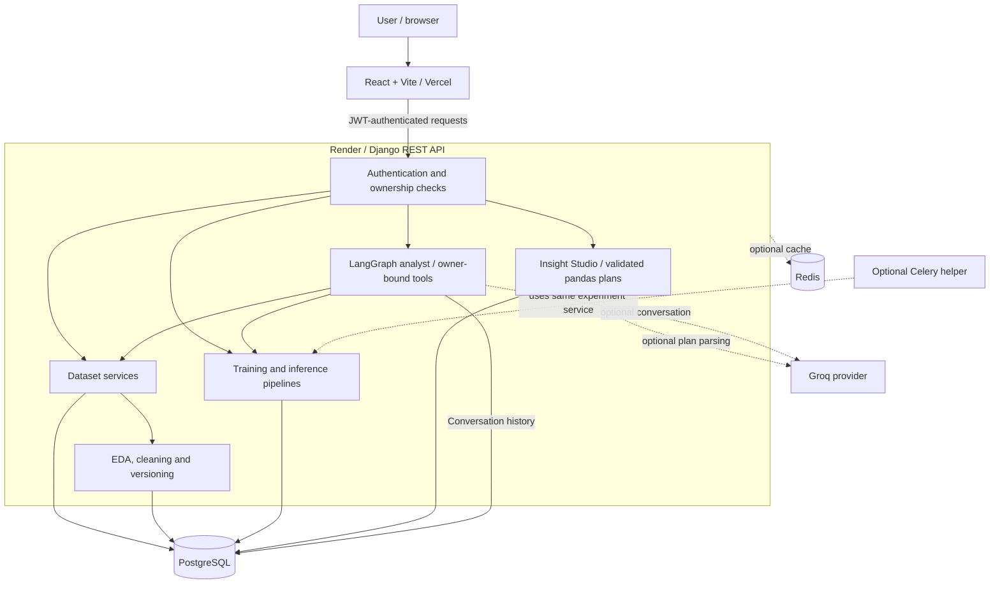

# Autonomous Data Scientist

A browser-based data science workspace for exploring CSV datasets, tracking cleaning changes, comparing predictive models, and answering analytical questions with grounded AI tools.


[Live application](https://autonomous-data-scientist-green.vercel.app/) · [Repository](https://github.com/Anshuman-utd/Autonomous-Data-scientist) · [Documentation](docs/README.md)

## Overview

Moving from a CSV to a useful model usually involves disconnected notebooks, cleaning scripts, charts, and inference code. This project brings those steps into one authenticated workspace while keeping results connected to their source data.

Users choose transformations and training targets. AI assists with analytical questions: Insight Studio validates a structured plan before pandas executes it, and the conversational analyst uses owner-bound LangGraph tools. Neither workflow executes LLM-generated code.

The revamp is merged into `main` and deployed on Vercel and Render, as reported by the maintainer. Historical local validation remains separately dated in [test results](docs/TEST_RESULTS.md).

## Application preview

These are real local QA captures using controlled fixture datasets, not generated mockups or production customer data. Additional responsive captures are in [the screenshot gallery](docs/SCREENSHOTS.md).



<details>
<summary>Explore data, model results, insights, and version history</summary>






</details>

## Key features

| Workflow | Implemented behavior |
| --- | --- |
| Dataset management | Validated CSV uploads; searchable, filtered, paginated library; previews, duplicate, download, and confirmed deletion |
| Exploratory analysis | Descriptive statistics, missing values, numerical histograms, category frequencies, Pearson correlation, and IQR outliers |
| Cleaning | Non-destructive previews, explicit confirmation, numeric/categorical imputation, duplicate removal, outlier-row removal, and column removal |
| Version history | Immutable snapshots, transformation parameters, before/after comparisons, CSV downloads, restore-as-new-version, and source lineage |
| Model training | Classification/regression candidates; train-only fitted preprocessing; real holdout metrics, comparison, and persisted pipelines |
| Predictions | Model-specific input forms, classification probabilities where available, regression values, reset, and scenario exploration |
| Insight Studio | Natural-language questions, validated plans, deterministic pandas results, charts, source evidence, and saved insights |
| Conversational analyst | Dataset-aware LangGraph tools, owner-scoped access, saved conversation history, and Markdown responses |
| Exports | CSVs, printable HTML reports, serialized models, and FastAPI/Docker inference bundles |

See [supported operations and constraints](docs/FEATURES.md) and [API contracts](docs/API.md).

## Technology stack

| Layer | Technologies |
| --- | --- |
| Frontend | React 19, Vite 8, Tailwind CSS 3, React Router 7, Recharts, Axios |
| Backend | Python 3.11, Django 5.2.17, Django REST Framework 3.18.2 |
| AI / agents | LangChain Core 1.8.4, LangGraph 1.2.24, Groq integration 1.2.1 |
| Machine learning | scikit-learn 1.4.2, pandas 2.2.2, NumPy 1.26.4 |
| Database | PostgreSQL through DATABASE_URL; SQLite fallback locally |
| Authentication | SimpleJWT 5.5.1; authenticated resource ownership checks |
| Deployment | Vercel frontend; Render backend; Gunicorn and WhiteNoise |
| Testing | Django tests, Vitest, Testing Library, HTTP and export smoke utilities |
| Optional infrastructure | Redis cache and Celery helper; interactive training remains synchronous |

Manifests and lock/constraint files are authoritative. The [dependency audit](docs/DEPENDENCY_AUDIT.md) explains the retained sklearn advisory and historical serialization compatibility.

## System architecture



Django handles authorization before analytical work. ML pipelines fit preprocessing on training rows and persist the fitted estimator. Insight plans run through bounded, deterministic operations; analyst tools are bound to the selected owner and dataset before model invocation. PostgreSQL retains data independently of Render's ephemeral disk. Optional cache/worker components are not a claim that Redis or Celery is deployed.

## How it works

1. Create an account and upload a CSV.
2. Inspect schema, completeness, distributions, and relationships.
3. Preview a cleaning operation and confirm it as a new version.
4. Choose a target, train candidates, and compare actual holdout metrics.
5. Run predictions using the saved model's original schema and pipeline.
6. Ask analytical questions, inspect evidence, and save useful insights.
7. Export reports, datasets, models, or inference service files.

## Project structure

```text
backend/
  api/agent/         Owner-bound analyst tools and LangGraph workflow
  api/ml/            Training, evaluation and shared inference
  api/utils/         EDA, CSV handling, reports and artifacts
  api/migrations/    Additive schema history
  api/insights.py    Restricted analysis plans and calculations
  api/versions.py    Immutable snapshots and cleaning operations
  core/              Django, database, cache and execution settings
frontend/src/
  pages/             Route-level screens
  components/        Layout, charts and shared controls
  features/          Dataset, EDA, cleaning, training, insight and chat workflows
  lib/               API, session refresh and downloads
  test/              Component and session tests
docs/                API reference, feature details and dated validation evidence
```

## Local development setup

Use **Python 3.11** and **Node 22.12+**. Build a fresh backend environment
when upgrading from the previous dependency stack; removed packages should not
linger in the runtime. Keep sklearn serialization versions aligned
with the backend and exported requirements.

```bash
cd backend
python3.11 -m venv venv
source venv/bin/activate
python -m pip install -r requirements.txt
# Copy only when no local .env exists.
cp -n .env.example .env
# Set a private SECRET_KEY in .env; DEBUG=True is local development only.
python manage.py migrate
python manage.py runserver
```

In another terminal:

```bash
cd frontend
npm ci
cp -n .env.example .env.local
npm run dev
```

Open the URL printed by Vite. Defaults allow both `localhost:5173` and
`127.0.0.1:5173`; an existing `CORS_ALLOWED_ORIGINS` value overrides the defaults,
so include the exact origin you use. Do not place credentials in `VITE_*` values.
A fixture CSV is included at `docs/fixtures/retail-workflow.csv` for local checks;
it is explicitly test data, never automatically inserted into a real account.

## Environment variables

| Variable | Purpose / requirement / service |
| --- | --- |
| `SECRET_KEY` | Required with `DEBUG=False`; retain an existing deployment key |
| `DEBUG` | Defaults to `False`; set `True` only for local development |
| `DATABASE_URL` | PostgreSQL URL; absent uses local SQLite |
| `ALLOWED_HOSTS` | Comma-separated backend hostnames |
| `CORS_ALLOWED_ORIGINS` | Exact permitted frontend origins |
| `WEB_CONCURRENCY` | Optional Docker/Gunicorn worker count; defaults to 1 to bound memory |
| `MEDIA_ROOT` | Optional disk-cache directory; database backups remain authoritative |
| `GROQ_API_KEY` | Optional conversational analyst / complex insight planning |
| `GROQ_MODEL` | Optional provider model override |
| `REDIS_URL`, `USE_REDIS_CACHE` | Optional shared cache and shared throttle buckets |
| `CELERY_BROKER_URL`, `CELERY_RESULT_BACKEND`, `CELERY_ALWAYS_EAGER` | Optional Celery configuration; no broker needed for interactive features |
| `VITE_API_URL` | Frontend/Vercel: required for hosted API connectivity; public backend origin only |

Unless marked Frontend/Vercel, these variables apply to the backend/Render. SECRET_KEY is required in production; DEBUG=False and explicit host/CORS configuration are production requirements. DATABASE_URL is required for PostgreSQL and optional for local SQLite. Provider, cache, worker-count and Celery variables are optional.

Upload and history limits are explicit server constants in `core/settings.py`
and match the upload UI. Change both if adapting these limits.

## Testing and validation

The standard suites use isolated SQLite and mocked external AI services; no
provider keys, Redis, or PostgreSQL are required.

```bash
# From the repository root
backend/venv/bin/python backend/manage.py check --settings=core.test_settings
backend/venv/bin/python backend/manage.py test api --settings=core.test_settings
backend/venv/bin/python backend/manage.py makemigrations --check --dry-run --settings=core.test_settings

cd frontend
npm test
npm run lint
npm run build
npm audit --omit=dev
```

For optional standalone FastAPI export verification, install
`backend/requirements-dev.txt` in a separate Python 3.11 environment, then from
`backend/` run `python -m api.export_smoke /absolute/path/to/deployment.zip`.
Only validate a bundle you trust: serialized sklearn files are executable data.


These commands are provided for reproduction; dated execution counts belong to [the validation record](docs/TEST_RESULTS.md). The local HTTP runner is `python -m api.http_smoke` from `backend/`, with QA_BASE_URL, QA_EMAIL and QA_PASSWORD for an isolated local database; it creates and removes its own fixture dataset.

## Deployment

The application is already deployed on **Vercel (frontend)** and **Render (Django/PostgreSQL)**. The maintainer reports the revamp merged and deployed from `main`. When GitHub auto-deploy is enabled in those service dashboards, pushes to the configured main branch trigger their builds; dashboard configuration is not stored or independently verified here.

| Service | Repository-backed configuration |
| --- | --- |
| Vercel | Root `frontend`, `npm ci`, `npm run build`, output `dist`; `frontend/vercel.json` provides SPA fallback |
| Render | Install `backend/requirements.txt` with adjacent `constraints.txt`; configure PostgreSQL DATABASE_URL and the required Django environment |
| Backend preparation | From `backend/`: `python manage.py migrate --noinput` and `python manage.py collectstatic --noinput` |
| Backend process | From `backend/`: `gunicorn core.wsgi:application --bind 0.0.0.0:$PORT --workers 1 --timeout 180`; confirm the actual Render dashboard start command |

Preserve existing secrets, take database backups before migrations, and use DEBUG=False with the correct ALLOWED_HOSTS and exact frontend CORS origin. VITE_API_URL must point to the HTTPS backend origin. Never put private keys in VITE variables or expose private media through a public file server.

The retained Dockerfile runs migrations/static collection and binds port 8000, with WEB_CONCURRENCY controlling workers. Its dependency installation references constraints.txt before that file is copied into the image; this documentation-only pass does not change the Dockerfile. Treat the Docker build as requiring a separately reviewed packaging fix, not a verified deployment path. Optional Compose also requires private SECRET_KEY and POSTGRES_PASSWORD environment values. No hosting settings were changed by this task.

## Data and model persistence

| Record | Durable contents |
| --- | --- |
| Dataset | CSV text, active snapshot reference, schema and EDA metadata |
| DatasetVersion | Immutable CSV, metadata, operation parameters and creation time |
| ModelRecord | Serialized binary, task/schema/evaluation metadata and source version |
| SavedInsight | Question, validated plan, computed chart/evidence, interpretation and source version |
| ChatHistory | Owner-scoped dataset questions, answers and timestamps |

PostgreSQL is the deployed persistence layer; SQLite is used when DATABASE_URL is absent locally. Disk files are reconstructible caches, not the authoritative store. Model database bytes take precedence over potentially reused legacy file paths. New CSVs preserve version 1; restored snapshots create new versions. Existing pre-versioning data can only preserve the recoverable baseline, not previously overwritten originals.

## Limitations

- UTF-8 CSV only: 10 MB, 100,000 rows and 100 columns per upload.
- History is bounded to 20 snapshots / 100 MB of snapshot text per dataset; versions are not silently pruned.
- Interactive training is synchronous, limited to 25,000 rows and an encoded-feature budget. Evaluation is a seeded holdout comparison, not cross-validation or an independent final test.
- Basic Insight Studio questions work offline; complex planning and the conversational analyst require Groq credentials. Provider failures produce errors rather than fabricated results.
- Importance uses supported model coefficients or impurity weights; SHAP, tuning and ROC visualization are not claimed.
- Reports are printable HTML, not generated PDFs. Inference exports are files, not a hosted model deployment.
- Refresh tokens remain in localStorage; server revocation and HttpOnly refresh cookies are future work. The scoped sklearn advisory is documented in the dependency audit.

## Future improvements

Not yet implemented: experiment tracking, cross-validation and tuning, batch inference, drift monitoring, richer bounded multi-step analysis, and object storage for larger artifacts.

## Author and license

Maintained by [Anshuman-utd](https://github.com/Anshuman-utd). No license file is present in this repository; no open-source license grant is asserted here.
